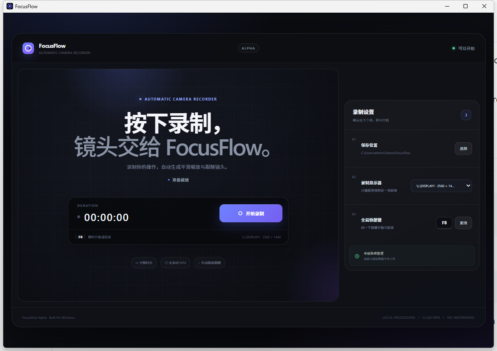

# FocusFlow

[](https://github.com/thomaslovebang/FocusFlow9/releases/latest)
[](https://github.com/thomaslovebang/FocusFlow9/releases/latest)
[](LICENSE)

FocusFlow is a focused Windows screen recorder. It records the screen and mouse locally, turns mouse actions into automatic zoom and pan, and exports a watermark-free MP4.

The current product has one workflow: choose a display, save folder, and start/stop shortcut; record for as long as needed; then follow the local processing stages and play either the automatically directed video or the untouched source recording.

FocusFlow 0.2 introduces a recording-first workspace with a compact left navigation rail. The recording canvas owns the main area, while dedicated pages provide recording settings, interface language, and installed-version information. The active navigation item is visibly enlarged with a blue focus border.



## Download

Download the latest Windows installer from [GitHub Releases](https://github.com/thomaslovebang/FocusFlow9/releases/latest). The installer includes the video engine; users do not need to install FFmpeg, Node.js, or Rust.

FocusFlow Alpha supports 64-bit Windows 10 and Windows 11. The first public version is unsigned, so Windows SmartScreen may ask for confirmation before installation.

## Quick start

1. Install and open FocusFlow.
2. Choose one display and a save folder.
3. Keep the default `F8` shortcut or choose another single key.
4. Start recording, complete the demonstration, then press the shortcut again.
5. Wait for local mouse analysis and automatic camera rendering, then play the final or original MP4.

After a successful recording, the selected folder contains only two files: the untouched original MP4 and the automatically directed final MP4. Temporary mouse, camera, project, filter, and render-log files are removed automatically.

## Build from source

From `apps/desktop` on Windows:

```powershell
npm install
npm run prepare:ffmpeg
npm run tauri dev
```

Check the Rust workspace from the repository root:

```powershell
cargo check --workspace
```

`npm run prepare:ffmpeg` downloads the pinned FFmpeg 9.0.2 Essentials package, verifies its SHA-256 checksum, and prepares only `ffmpeg.exe`, `ffprobe.exe`, and the legal files used by the bundle. Run `npm run bundle` to produce the Windows NSIS installer.

## Current product scope

- No artificial recording time limit.
- No watermark.
- Automatic zoom and pan generated from mouse clicks and movement.
- Select one display to record on multi-monitor systems.
- User-selected output folder.
- One configurable global shortcut that starts and stops recording.
- Visible save, mouse-analysis, and automatic-camera rendering stages.
- A finished-video result with Open Folder, Play Final Video, and Play Original Video actions.
- A clean output folder containing only the original and final MP4 after successful processing.
- A responsive interface that fills the available window when maximized.
- A branded FocusFlow icon for the app window, executable, and installer.
- A left navigation rail with dedicated Recording Settings, Language, and Updates pages.
- Interface language choices for Follow System, Chinese, English, Japanese, French, German, Spanish, and Arabic.
- Arabic automatically uses a right-to-left interface direction.
- The default `F8` global shortcut works immediately on first launch without being saved again.
- Recoverable error feedback that keeps the saved source recording accessible.

Manual timelines, project opening, clip editing, camera keyframes, and director-style settings are outside the current product.

## Alpha limitations

- Windows only.
- System audio and microphone recording are not included yet.
- The automatic camera is intentionally zero-edit in this version.
- The installer is not code-signed yet.

Please report reproducible problems through the [Bug report form](https://github.com/thomaslovebang/FocusFlow9/issues/new?template=bug_report.yml).

## Workspace

- `apps/desktop`: Tauri and React desktop shell
- `crates/domain`: shared domain models
- `crates/recorder`: recording contracts and session lifecycle
- `crates/tracker`: mouse tracking contracts
- `crates/focus_engine`: automatic camera timeline generation
- `crates/editor_core`: retained experimental editing core; not exposed in the current app
- `crates/renderer`: FFmpeg video rendering
- `crates/media`: FFmpeg/FFprobe integration boundary
- `crates/project_store`: project and edit-timeline persistence
- `crates/platform_windows`: Windows-specific adapters
- `docs`: architecture, data contracts, and historical phase notes

## Scope

V1 is Windows-only. Processing stays on the machine: no cloud services, accounts, or watermark.

FocusFlow is MIT licensed. Release installers also bundle separate FFmpeg executables under GPLv3; see [third-party notices](THIRD_PARTY_NOTICES.md).

Older phase write-ups under `docs/` are historical test and design notes.

